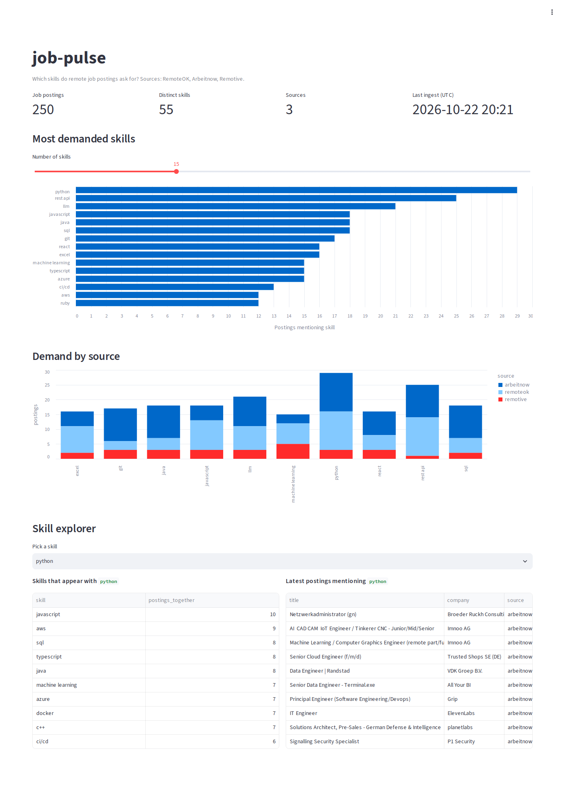
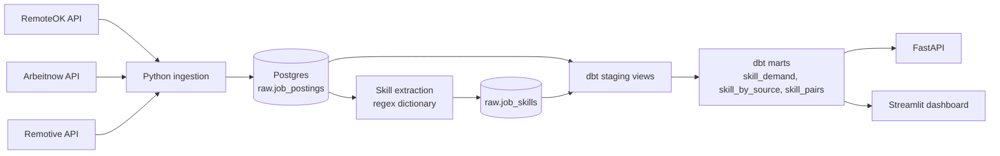

# job-pulse

End-to-end data engineering project that answers one question: **which skills do remote job postings actually ask for?**

It ingests remote job postings from three public APIs, extracts skills from the text, models the data with dbt, and serves it through a REST API and a dashboard.



## Architecture



## Stack

Python, PostgreSQL 16, dbt (postgres adapter, run in Docker), FastAPI, Streamlit, Docker Compose, GitHub Actions, pytest, ruff.

## Quick start

Requires Docker and Python 3.12+.

```bash
python -m venv .venv
source .venv/Scripts/activate      # Windows Git Bash; use .venv/bin/activate on Linux/macOS
pip install -r requirements.txt

./run.sh                           # Postgres -> ingest -> extract skills -> dbt build

uvicorn api.main:app --port 8000   # API docs: http://localhost:8000/docs
streamlit run dashboard/app.py     # Dashboard: http://localhost:8501
```

## API

| Endpoint | Description |
|---|---|
| `GET /health` | Service and database check |
| `GET /skills/top?limit=20` | Most demanded skills |
| `GET /skills/{skill}` | Demand for one skill, overall and per source |
| `GET /skills/{skill}/related` | Skills that co-occur with it |
| `GET /jobs?skill=python` | Latest postings mentioning a skill |

## Data model

- `raw.job_postings`: one JSONB payload per posting, keyed by `(source, id)`; re-running ingestion upserts.
- `raw.job_skills`: `(source, id, skill)` rows from the extraction step.
- `analytics_staging.*`: dbt views that map the three source schemas onto common columns.
- `analytics_marts.*`: `mart_skill_demand`, `mart_skill_by_source`, `mart_skill_pairs`, all with dbt tests.

## Design notes

- Skills are matched with a curated dictionary of regex patterns (`src/skills.py`) with guards for ambiguous names, for example `java` vs `javascript`, and `go` only as `golang` or "Go developer". Unit tests cover the tricky cases.
- dbt runs from the official Docker image, so no extra Python toolchain is needed on the host.
- Source note: Remotive's public API returns only 10 postings per call, so RemoteOK and Arbeitnow provide most of the volume.

## Tests and CI

```bash
python -m pytest tests -q
```

GitHub Actions runs ruff, the extraction unit tests and a compose-file validation on every push. The API tests need a running database and skip themselves otherwise.
